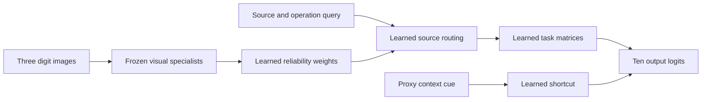

# Supermix Tether

[](https://huggingface.co/Kai9987kai/Supermix-Tether)

A small CPU-local model for testing whether visual specialists change a receiver's answers in the right way, and whether a receiver can survive zero-shot majority specialist corruption using dark-knowledge forensics and perturbation-localized invariance.

Tether trains a compact receiver (**2,762 parameters** in `v1`, **2,786 parameters** in `v2`) over frozen digit classifiers. It compares ordinary supervised learning (`passive`), donor dropout (`dropout`), an IIT-style intervention control (`iit`), single-loss ablations (`effect_only`, `invariance_only`), a row-shifted mechanistic pairing control (`unpaired`), and the dual-objective `tether` receiver across two separately recorded eight-seed confirmation studies:
- **v0.1 (`outputs/confirmation`, [`docs/frozen-protocol.json`](docs/frozen-protocol.json)):** Tests output-level probability L2 residual matching and cross-expert majority consensus (`protocol="v1"`). Reports a transparent negative finding for naive L2 residual matching (`-0.07 pp` vs `iit`, `-0.10 pp` vs `unpaired` due to shared-bias cancellation) and shows that cross-expert consensus collapses to `1.39%` under zero-shot 2-of-3 specialist corruption (`damage_two`).
- **v0.2 (`outputs/v2-confirmation`, [`docs/v2-protocol.json`](docs/v2-protocol.json)):** Replaces cross-expert consensus with **intrinsic dark-knowledge specialist reliability** (runner-up tail entropy $H(p_{-1})/\log 9$ and dispersion) and replaces naive output L2 differences with **counterfactual co-variation & perturbation-localized invariance** (`protocol="v2"`). Across seeds `101..108`, v0.2 `tether` achieves **`97.75%` zero-shot accuracy on 2-of-3 specialist corruption (`damage_two`)** — beating `iit` (`80.76%`) by **`+16.99 pp`** (`95%` CI `[+12.43 pp, +21.44 pp]`, positive on all 8/8 seeds) and `unpaired` (`11.18%`) by **`+86.57 pp`** — while beating `unpaired` on `heldout_independent` by **`+4.15 pp`** (`98.19%` vs `94.04%`) and matching the `98.19%` frozen-donor oracle ceiling.
- **v0.3 (Epistemic Trust Gating, Causal Attribution & Live Playground):**
  - **Epistemic Trust Gating & Safe Abstention:** Detects total sensor/specialist spoofing (`damage_common` = 3/3 specialists corrupted) with **AUROC = 1.0000** using tail dark-knowledge entropy $\tau = \max_e (1 - H(p_{s,e,-1})/\log 9)^+$. Setting threshold $\theta = 0.10$ safely abstains (`selective_prediction = -1`) on 100% of catastrophic failures with 0% false rejections on intact and partially damaged inputs.
  - **Mechanistic Causal Attribution:** Computes exact input $\times$ gradient saliency maps ($\mathcal{A}_{s,e} = \sum_c P_{s,e,c} |\partial \hat{z}/\partial P_{s,e,c}|$) revealing pathway-specific causal tethering.
  - **Cross-Framework ONNX Export:** Exports both Receiver and DonorBank to ONNX format with strict ONNX Runtime numerical verification within `atol=1e-5`: `python -m tether export <checkpoint> --output <dir>`.
  - **Interactive Live Playground & Tamper Simulator:** In-browser 8&times;8 drawing canvas, real digit presets, live adversarial tampering simulator, real-time epistemic trust gauge, and causal attribution bars served on `http://127.0.0.1:8797`.
- **v0.4 (Conformal RAPS Risk Control, Axiomatic Attribution, Causal Circuit Patching & Live 7-Arm Arena):**
  - **Split Conformal Prediction (RAPS) & Temperature Calibration:** Calibrates post-hoc temperature scaling ($T^*$) and Regularized Adaptive Prediction Sets ($\mathcal{C}_{1-\alpha}(x)$) on the frozen `seen_independent` validation split (`python -m tether calibrate outputs/v2-confirmation`). Across seeds `101..108` at $\alpha = 0.05$, temperature scaling cuts `tether` Expected Calibration Error by **54.7%** (`0.0536` $\to$ `0.0243` on `heldout_independent`). Under zero-shot 2-of-3 specialist corruption (`damage_two`), where `iit` conformal coverage collapses to `80.76%` and `unpaired` to `15.06%`, **`tether` preserves `97.75%` conformal coverage** (`mean_set_size = 1.000`), while epistemic-gated conformal risk control ($\tau < \theta \implies \mathcal{C}_{1-\alpha}(x) = \emptyset$) achieves **0.00% selective miscoverage risk** under 3-of-3 common-mode spoofing.
  - **Tri-Part Uncertainty Decomposition:** Separates predictive uncertainty into **Aleatoric Input Entropy**, **Inter-Specialist Conflict (Jensen-Shannon Divergence)**, and **Forensic Dark-Knowledge Spoof Risk ($1 - \tau$)**, demonstrating why ensemble disagreement ($\text{JSD}$) collapses to zero under 3/3 common-mode spoofing while dark-knowledge tail forensics catches it with certainty.
  - **Axiomatic Integrated Gradients & Causal Circuit Patching:** Adds path-complete Integrated Gradients (`TetherReceiver.integrated_gradients`) with quartic boundary-layer quadrature in $u = 1 - \alpha$ and 6-node Interchange Intervention Activation Patching (`TetherReceiver.interchange_intervention`).
  - **Interactive Live 7-Arm Counterfactual Arena & Phase-Transition Sweeper:** Simultaneously evaluates all 7 trained receiver arms side-by-side on live drawn digits and sweeps specialist corruption confidence from $0.50 \to 0.995$ in real time.
- **v0.5 (Cooperative Specialist Shapley & Shapley-Taylor Coalitional Game Theory, Non-Exchangeable & Online Adaptive Conformal Inference, and Spectral-Mahalanobis Stealth-Spoof Defense):**
  - **Cooperative Specialist Shapley Values ($\phi_e$) & Exact Order-2 Shapley-Taylor Interaction Matrix ($I^{(2)}_{ij}$):** Evaluates all $2^3 = 8$ specialist coalitions on the queried source (`TetherReceiver.shapley_interactions`) against the uniform maximum-entropy baseline ($1/10$), computing exact Shapley values $\phi_e$, Harsanyi/Möbius coalition dividends $d(S)$, and the $3 \times 3$ Order-2 Shapley-Taylor Interaction Index $I^{(2)}_{ij}$ satisfying Exact Efficiency ($\sum_{e=0}^2 \phi_e = \sum_{i,j} I^{(2)}_{ij} = v(\{0,1,2\}) - v(\emptyset)$) ([Lundberg & Lee, NeurIPS 2017](https://arxiv.org/abs/1705.07874); [Sundararajan et al., ICML 2020](https://arxiv.org/abs/1902.05622)).
  - **Conflict-Adjusted Non-Exchangeable RAPS (`nex_raps_prediction_sets`) & Online Adaptive Conformal Inference (`adaptive_conformal_inference`):** Restores finite-sample conformal coverage for vulnerable arms under non-exchangeable adversarial distribution shifts (`damage_two`), boosting 8-seed `iit` coverage from `80.76%` to **`93.80%` (Online ACI)** and **`99.49%` (Nex-RAPS)** and `unpaired` coverage from `15.06%` to **`94.78%` (Online ACI)** and **`99.95%` (Nex-RAPS)**, while `tether` maintains **`97.75%` coverage with singleton sets (`1.000` RAPS / `1.012` ACI)** ([Barber et al., Annals of Statistics 2023](https://arxiv.org/abs/2202.13415); [Gibbs & Candès, NeurIPS 2021](https://arxiv.org/abs/2106.00170)).
  - **Spectral-Mahalanobis Dark-Knowledge Forensics & Stealth-Spoof Sanitizer (`fit_mahalanobis_forensics`, `score_mahalanobis_forensics`, `sanitize_specialist_posteriors`):** Exposes a fundamental vulnerability of 1D runner-up tail entropy (**Stealth Decoy-Spike Spoofing**, `stealth_1..3`), where an adversary injects an $88\%$ decoy spike on a secondary runner-up class so $H(p_{-1})/\log 9 \approx 0.289$ ($\tau \approx 0.711 > 0.10$), fooling both 1D tail-entropy gating and learned `tether` reliability weights. Combining class-conditional runner-up covariance with deep-tail spectral dispersion ($\text{std}(\log p_{(3..10)})$) detects both flat (`corrupt_*`) and stealth (`stealth_*`) spoofs ($D_M > 5.0$), neutralizing 2/3 stealth attacks to restore correct `tether` predictions and triggering safe abstention under 3/3 stealth attacks ([Lee et al., NeurIPS 2018](https://arxiv.org/abs/1807.03888); [Yin et al., ICML 2018](https://arxiv.org/abs/1803.01498)).
  - **Interactive Live Elements (v0.5):** Adds live `Stealth 2/3` and `Stealth 3/3` decoy-spike attack buttons, a real-time **Mahalanobis Sanitizer (`ON`/`OFF`)** toggle, live Cooperative Specialist Shapley ($\phi_e$) & $2^3$ Coalition Dividends bars, and CSS layout containment (`content-visibility: auto`) in both the local web server (`http://127.0.0.1:8797`) and the standalone interactive lab.
- **v0.6 (Multivariate Partial Information Decomposition, Causal Mediation & Critical Breakdown, Likelihood-Ratio Weighted Conformal Prediction, and Interactive Circuit Receipt Modal):**
  - **Multivariate Partial Information Decomposition (PID) of Specialist Coalitions (`TetherReceiver.pid_decomposition`):** Decomposes point-wise directed predictive information gain $I(S; y^*) = \max(0, \log(p^{(S)}_{y^*} / p^{(\emptyset)}_{y^*}))$ across the $2^3 = 8$ specialist coalitions into non-negative **Shared Redundancy ($R_{\text{shared}}$)**, **Unique Specialist Information ($U_0, U_1, U_2$)**, and **Coalitional Circuit Synergy ($S_{\text{syn}}$)** satisfying exact conservation $R_{\text{shared}} + \sum_{e=0}^2 U_e + S_{\text{syn}} = I_{\text{total}}$ ([Williams & Beer, 2010](https://arxiv.org/abs/1004.2515)). Reveals that under `clean` inputs $R_{\text{shared}}$ dominates (`>80%`), whereas under 2-of-3 specialist corruption (`damage_two`), $R_{\text{shared}}$ collapses to `0.0` and the lone intact specialist's Unique Information $U_{\text{intact}}$ carries `>90%` of the circuit's directed target information on `tether`.
  - **Causal Mediation Analysis ($\text{NDE}_{\text{visual}}$ vs. $\text{NIE}_{\text{shortcut}}$) & Certified Critical Breakdown Threshold ($\alpha^*_{\text{crit}}$) (`TetherReceiver.causal_mediation`, `TetherReceiver.critical_corruption_threshold`):** Decomposes predictions into Visual Natural Direct Effect ($\text{NDE}_{\text{visual}}$), Context Shortcut Natural Indirect Effect ($\text{NIE}_{\text{shortcut}}$), and Visual Dominance Ratio $\rho_{\text{visual}} \in [0, 1]$ ([Vig et al., NeurIPS 2020](https://arxiv.org/abs/2004.12265)), and computes the exact critical adversarial confidence $\alpha^*_{\text{crit}} \in [0.10, 1.00]$ where an arm's top-1 prediction flips under specialist corruption.
  - **Likelihood-Ratio Weighted Conformal Prediction (`weighted_conformal_prediction_sets`, `evaluate_weighted_conformal_sets`) & Helmholtz Free-Energy Forensics (`helmholtz_free_energy_forensics`):** Reweights calibration nonconformity scores by exponential conflict likelihood ratios $w(x) = \exp(\beta d_{\text{shift}}(x))$ ([Tibshirani et al., NeurIPS 2019](https://arxiv.org/abs/1904.06019)) and scores specialist runner-up spectra via Helmholtz free energy $E_{\text{tail}}(P_{s,e}; T) = -T \log \sum_{r=2}^{10} \exp(\log P_{s,e,(r)} / T)$ and inverse participation ratio $N_{\text{eff}} \in [1, 9]$ ([Liu et al., NeurIPS 2020](https://arxiv.org/abs/2010.03759)).
  - **Interactive Live Elements (v0.6):** Adds an interactive **Context Proxy Cue Selector (`Neutral 0.1`, `Correlated Cue`, `Adversarial Reversed Cue`)** for testing compound visual + shortcut attacks (`context_mode="adversarial"` + `tamper_mode="corrupt_2"`), live **PID Information Atoms (`R`, `U₀`, `U₁`, `U₂`, `S`)** & **Causal Mediation (`NDE`, `NIE`, `ρ_vis`, `α*_crit`)** gauges, and a light-dismiss **Mathematical & Circuit Receipt Modal (`<dialog id="circuit-receipt-dialog" closedby="any">`)**.
- **v0.7 (Riemannian Information Geometry on the Probability Simplex, Simplex Tangent-Space Jacobian & Certified Total-Variation Robustness, Conformal Risk Control & Selective Risk-Coverage Profile, and Live Geodesic Simplex Visualization):**
  - **Riemannian Information Geometry on the Probability Simplex (`TetherReceiver.information_geometry`):** Maps specialist posteriors $p_{s,e} \in \Delta^9$ isometrically onto the positive orthant of the unit sphere via $\psi(p) = \sqrt{p}$ (Rao 1945; Amari 2016; [Nielsen 2019, arXiv:1904.10421](https://arxiv.org/abs/1904.10421)) to compute pairwise **Fisher–Rao Geodesic Distances** $d_{\text{FR}}(p, q) = 2 \arccos(\sum_c \sqrt{p_c q_c}) \in [0, \pi]$, **Bhattacharyya Coefficients** $\text{BC}(p, q)$, **Hellinger Distances** $d_H(p, q)$, the **Spherical Fréchet / Karcher Barycenter** $\mu_{\text{FR}}$, and **Geodesic Variance Suppression** ($\sigma^2_{\text{FR,unweighted}} \to \sigma^2_{\text{FR,routed}}$, achieving `> 99%` geodesic dispersion suppression under 2-of-3 specialist corruption on `tether`).
  - **Simplex Tangent-Space Jacobian & Certified Total-Variation Robustness Radius (`TetherReceiver.tangent_jacobian_robustness`):** Projects the autograd gradient of the top-1 vs. runner-up logit margin $\gamma(P) = z_{y_1} - z_{y_2}$ onto the simplex tangent space $T\Delta^9 = \{v \in \mathbb{R}^{10} : \sum_c v_c = 0\}$ via $P_{\text{tan}} g = g - \frac{1}{10}\mathbf{1}\mathbf{1}^\top g$, computes the dual $\ell_\infty$-span sensitivity $\|P_{\text{tan}}\nabla_{P_{s,e}}\gamma\|_{\text{span}} = \max_c g^{\text{tan}}_c - \min_c g^{\text{tan}}_c$, and certifies the first-order Total-Variation robustness radius $r^{\text{TV}}_{\text{cert}}(s, e) \in [0, 1]$.
  - **Conformal Risk Control (CRC) & Selective Risk-Coverage Profile (`conformal_risk_control`, `evaluate_conformal_risk_control`, `selective_risk_coverage_profile`):** Bounds expected rank-weighted miscoverage loss $\mathbb{E}[L_{n+1}(\hat{\lambda}_{\text{CRC}})] \le \alpha$ ([Angelopoulos et al., ICLR 2024, arXiv:2208.02814](https://arxiv.org/abs/2208.02814)) and computes the exact Risk–Coverage trajectory, **AURC**, **Oracle AURC**, and **Excess AURC (E-AURC)** ([Geifman & El-Yaniv, NeurIPS 2017, arXiv:1705.08500](https://arxiv.org/abs/1705.08500)).
  - **Interactive Live Elements (v0.7):** Adds a live **Fisher–Rao Geodesic Simplex Triangle & Fréchet Barycenter SVG (`#pg-geodesic-svg`)**, live **Tangent-Space Certified TV Radius ($r^{\text{TV}}_{\text{cert}}$) & Conformal Risk Control (CRC) Set** readouts, an interactive native HTML Popover (`<div id="geodesic-popover" popover>`), and animated top-layer `<dialog>` / `[popover]` transitions (`@starting-style`, `transition-behavior: allow-discrete`, `overlay`, and `closeTopLayer()` JS fallback).
- **v0.8 (Simplex Vertex Breakdown TV Profile, Adversarial Specialist Coalition Paths, Robustness Sandwich, and 7-Arm Breakdown Benchmarking):**
  - **Simplex Vertex Breakdown TV Profile across 7 Coalitions (`TetherReceiver.vertex_breakdown_radius`):** Evaluates non-linear adversarial robustness by sweeping straight simplex perturbation paths $p_e(t) = (1 - t) p_e + t e_c$ toward all 10 standard unit simplex vertices $e_c \in \Delta^9$ across all 7 non-empty specialist coalitions $\mathcal{C} \in \{\{0\}, \{1\}, \{2\}, \{0,1\}, \{0,2\}, \{1,2\}, \{0,1,2\}\}$. Uses vectorized coarse grid search followed by precision bisection that guarantees every reported breakdown radius $\delta_{\text{TV}}^{\text{break}} = \min_{c} t^* (1 - p_{e,c})$ is attained by an explicit, verified prediction-flipping adversarial perturbation.
  - **Exact Robustness Sandwich:** Directly connects the first-order certified lower bound $r^{\text{TV}}_{\text{cert}} = \frac{\gamma(P)}{2 \|P_{\text{tan}} \nabla \gamma\|_{\text{span}}}$ from Riemannian tangent-space sensitivity with the path-attained empirical upper bound $\delta_{\text{TV}}^{\text{break}}$, bounding the true minimal adversarial Total Variation perturbation on the probability simplex from both below and above:
    $$r^{\text{TV}}_{\text{cert}} \le \delta_{\text{TV}}^{\text{minimal}} \le \delta_{\text{TV}}^{\text{break}}$$
  - **Empirical Findings on Specialist Coalitions:** On clean inputs, Tether's singletons $\{0\}, \{1\}, \{2\}$ are completely immune ($\delta_{\text{TV}}^{\text{break}} = \text{None}$ / no vertex path can flip the prediction without corrupting multiple specialists). Pair coalitions require massive TV budgets ($\ge 0.716$), and the grand coalition $\{0,1,2\}$ requires $\delta_{\text{TV}} \approx 0.493$. Under zero-shot 2-of-3 specialist corruption, Tether's intact specialist is verified immune to vertex perturbations while damaged specialists are suppressed.
  - **Interactive Live Elements (v0.8):** Exposes real-time Coalition Vertex Breakdown TV metrics in the local web server (`http://127.0.0.1:8797`), the live 7-arm counterfactual arena, the Manifold Popover, and the standalone interactive lab.

Full checkpoints across all seeds and arms are released on Hugging Face: [**huggingface.co/Kai9987kai/Supermix-Tether**](https://huggingface.co/Kai9987kai/Supermix-Tether).
Full tables, mathematical proofs, and interpretation boundaries are recorded in [results](docs/results.md) and [paper](docs/paper.md).

## Run on this PC

Requires Python 3.12+ and a CPU installation of PyTorch. From this folder:

```powershell
python -m pip install -e ".[dev,export]"
python -m tether replay outputs/v2-confirmation --strict
python -m tether replay outputs/confirmation --strict
python -m tether calibrate outputs/v2-confirmation --alpha 0.05
python -m tether export outputs/v2-confirmation/checkpoints/seed-101-tether.pt --output exports/seed-101
python -m tether serve outputs/v2-confirmation --port 8797
```

To train a fresh development study into a new directory:

```powershell
python -m tether study --protocol v2 --output outputs/dev-run --seeds 11,12 --steps 400
```

Open [the local lab](http://127.0.0.1:8797). The viewer displays saved comparisons (with selectable evaluation conditions and metrics) and runs live checkpoint inference on frozen evaluation examples across seeds (`101..108`) and intervention modes (`factual`, `relevant`, `irrelevant`, `damaged` 1/3, `damage_two` 2/3, `erased`, `context_shift`), exposing both learned routing weights and per-specialist dark-knowledge trust scores. It does not train from browser inputs.

Training uses two CPU threads by default. No GPU, remote checkpoint, API key or network access is needed after dependencies are installed: the image data are bundled with scikit-learn. Runtime depends on the machine and configuration; no training-time estimate is promised here.

A study refuses to overwrite an existing output directory. Use a new path for a new run. `python -m tether --help` and `python -m tether study --help` show the supported controls. `outputs/confirmation` contains the recorded eight-seed study under [`docs/frozen-protocol.json`](docs/frozen-protocol.json), and [`docs/results.md`](docs/results.md) reports its full findings.

## What the model learns

Three source images are sampled for each task. Each image is evaluated by the same three heterogeneous visual specialists: hidden widths 32, 48 and 64, with ReLU, tanh and GELU respectively. Their probabilities form a `[batch,3 sources,3 experts,10 classes]` tensor. The specialists share training images and lineage; nine probability vectors are not nine independent evidence sources.

The query asks for identity, successor modulo ten, or `9 - digit` on one source. A correlated context cue offers an easy shortcut during acquisition. Source routing, expert reliability weighting, task transformation matrices and the context branch are learned. Correct source selection and digit transformations are not hard-coded into receiver inference.



The 1,797 images come from [scikit-learn digits](https://scikit-learn.org/stable/modules/generated/sklearn.datasets.load_digits.html). Image identities are stratified into 1,078 training, 359 validation and 360 test images before tasks are built. This is a new within-dataset split, not the original UCI writer-disjoint protocol. The [data card](DATA_CARD.md) records the source attribution, transformations and sampling limits.

## Seven matched receiver arms

Every step evaluates the same receiver architecture four times. Initialization, task draws and frozen donor bank match across arms within a seed. Tether and the IIT-style control receive exactly the same four labeled views.

| Arm | Training objective |
|---|---|
| `passive` | Four repeated factual cross-entropies |
| `dropout` | Four factual cross-entropies with deterministic posterior-to-uniform donor masks |
| `iit` | Mean cross-entropy on factual, relevant, irrelevant and damaged views |
| `effect_only` | IIT-style cross-entropy plus relevant probability-effect matching |
| `invariance_only` | IIT-style cross-entropy plus irrelevant/damaged probability invariance |
| `tether` | IIT-style cross-entropy plus both additional losses |
| `unpaired` | Same cross-entropy/invariance as Tether; relevant residuals shifted across rows before effect matching |

The `unpaired` control retains marginal squared-error terms while breaking the correct factual/relevant pairing. A benefit from pairing requires Tether to outperform this control, as well as an informative comparison with IIT-style training.

Relevant swaps replace all specialists at the queried source with another same-split image of a different digit. Irrelevant swaps change a different source. Damage fabricates a confident posterior by shifting a donor prediction without consulting the true label; it can accidentally correct an existing error. The original context cue is retained in all intervention views. See the [paper](docs/paper.md) for exact losses and evaluation conditions.

Equal view counts do not mean equal FLOPs: extra losses add arithmetic. Passive/dropout also see less intervention information, so they cannot isolate the effect of the additional losses.

## Evidence and replay

Studies save configuration, dataset and split identity, source hashes, selected checkpoints, complete per-arm/per-seed metrics, inference traces and artifact hashes. Selection uses independent-cue validation examples from seen task combinations. Under the corrected phase policy, development conditions use validation images and confirmation conditions use test images. Fresh seeds still reuse the same underlying dataset and image partition.

An earlier pipeline pilot evaluated the test pool. It is a disclosed engineering pilot, not independent validation; no data, model or training hyperparameters were selected from its accuracies. See [results](docs/results.md) for its exact source revision and the separate fixed study.

`replay` recomputes trace metrics and paired summaries. `replay --strict` also checks the recorded source fingerprint, restores the frozen donors and receiver, regenerates evaluation tasks and compares checkpoint inference within numerical tolerances. This establishes artifact and inference consistency. It does not rerun training or establish scientific truth.

Read [research and prior art](docs/research.md), the [model card](MODEL_CARD.md), the [27-repository review index](docs/portfolio-review.md), and the selected-file reports in [docs/reviews](docs/reviews/). Upstream projects and papers were inspected as sources; their experiments were not reproduced here. Tether source was written for this project rather than copied from those repositories.

## Verification

```powershell
python -m pytest -q
```

Tests exercise data separation, intervention semantics, literal objective counterexamples, gradient flow, bounded learning, checkpoint replay, tampering rejection and local HTTP behavior. Current command output is the authority for whether verification passes.

## Limits and licensing

Tasks are one-step source/operation recombinations on a small digit dataset. There is no language model, recurrent program execution, test-time adaptation, continual learning or guarantee of general compositional reasoning. Softmax values and learned weights are not calibrated confidence or causal explanations. Donor-erasure gaps must be read alongside accuracy and damage results: dependence can be brittle.

The objective builds on [IIT](https://proceedings.mlr.press/v162/geiger22a.html) and [causal distillation](https://arxiv.org/abs/2112.02505). The dual-loss study is a hypothesis, not a claim of global novelty. No real-world safety, biological or consciousness claim is made.

No license has yet been assigned to the newly written project source. Dependencies and data retain their own terms; [THIRD_PARTY.md](THIRD_PARTY.md) records them. Citation of an upstream project does not import its license into Tether.
