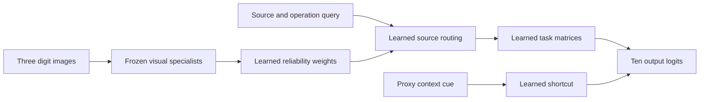

# Supermix Tether

[](https://huggingface.co/Kai9987kai/Supermix-Tether)

A small CPU-local model for testing whether visual specialists change a receiver's answers in the right way, and whether a receiver can survive zero-shot majority specialist corruption using dark-knowledge forensics and perturbation-localized invariance.

Tether trains a compact receiver (**2,762 parameters** in `v1`, **2,786 parameters** in `v2`) over frozen digit classifiers. It compares ordinary supervised learning (`passive`), donor dropout (`dropout`), an IIT-style intervention control (`iit`), single-loss ablations (`effect_only`, `invariance_only`), a row-shifted mechanistic pairing control (`unpaired`), and the dual-objective `tether` receiver across two separately recorded eight-seed confirmation studies:
- **v0.1 (`outputs/confirmation`, [`docs/frozen-protocol.json`](docs/frozen-protocol.json)):** Tests output-level probability L2 residual matching and cross-expert majority consensus (`protocol="v1"`). Reports a transparent negative finding for naive L2 residual matching (`-0.07 pp` vs `iit`, `-0.10 pp` vs `unpaired` due to shared-bias cancellation) and shows that cross-expert consensus collapses to `1.39%` under zero-shot 2-of-3 specialist corruption (`damage_two`).
- **v0.2 (`outputs/v2-confirmation`, [`docs/v2-protocol.json`](docs/v2-protocol.json)):** Replaces cross-expert consensus with **intrinsic dark-knowledge specialist reliability** (runner-up tail entropy $H(p_{-1})/\log 9$ and dispersion) and replaces naive output L2 differences with **counterfactual co-variation & perturbation-localized invariance** (`protocol="v2"`). Across seeds `101..108`, v0.2 `tether` achieves **`97.75%` zero-shot accuracy on 2-of-3 specialist corruption (`damage_two`)** — beating `iit` (`80.76%`) by **`+16.99 pp`** (`95%` CI `[+12.43 pp, +21.44 pp]`, positive on all 8/8 seeds) and `unpaired` (`11.18%`) by **`+86.57 pp`** — while beating `unpaired` on `heldout_independent` by **`+4.15 pp`** (`98.19%` vs `94.04%`) and matching the `98.19%` frozen-donor oracle ceiling.

Full checkpoints across all seeds and arms are released on Hugging Face: [**huggingface.co/Kai9987kai/Supermix-Tether**](https://huggingface.co/Kai9987kai/Supermix-Tether).
Full tables, mathematical proofs, and interpretation boundaries are recorded in [results](docs/results.md) and [paper](docs/paper.md).

## Run on this PC

Requires Python 3.12+ and a CPU installation of PyTorch. From this folder:

```powershell
python -m pip install -e ".[dev]"
python -m tether replay outputs/v2-confirmation --strict
python -m tether replay outputs/confirmation --strict
python -m tether serve outputs/v2-confirmation --port 8797
```

To train a fresh development study into a new directory:

```powershell
python -m tether study --protocol v2 --output outputs/dev-run --seeds 11,12 --steps 400
```

Open [the local lab](http://127.0.0.1:8797). The viewer displays saved comparisons (with selectable evaluation conditions and metrics) and runs live checkpoint inference on frozen evaluation examples across seeds (`101..108`) and intervention modes (`factual`, `relevant`, `irrelevant`, `damaged` 1/3, `damage_two` 2/3, `erased`, `context_shift`), exposing both learned routing weights and per-specialist dark-knowledge trust scores. It does not train from browser inputs.

Training uses two CPU threads by default. No GPU, remote checkpoint, API key or network access is needed after dependencies are installed: the image data are bundled with scikit-learn. Runtime depends on the machine and configuration; no training-time estimate is promised here.

A study refuses to overwrite an existing output directory. Use a new path for a new run. `python -m tether --help` and `python -m tether study --help` show the supported controls. `outputs/confirmation` contains the recorded eight-seed study under [`docs/frozen-protocol.json`](docs/frozen-protocol.json), and [`docs/results.md`](docs/results.md) reports its full findings.

## What the model learns

Three source images are sampled for each task. Each image is evaluated by the same three heterogeneous visual specialists: hidden widths 32, 48 and 64, with ReLU, tanh and GELU respectively. Their probabilities form a `[batch,3 sources,3 experts,10 classes]` tensor. The specialists share training images and lineage; nine probability vectors are not nine independent evidence sources.

The query asks for identity, successor modulo ten, or `9 - digit` on one source. A correlated context cue offers an easy shortcut during acquisition. Source routing, expert reliability weighting, task transformation matrices and the context branch are learned. Correct source selection and digit transformations are not hard-coded into receiver inference.



The 1,797 images come from [scikit-learn digits](https://scikit-learn.org/stable/modules/generated/sklearn.datasets.load_digits.html). Image identities are stratified into 1,078 training, 359 validation and 360 test images before tasks are built. This is a new within-dataset split, not the original UCI writer-disjoint protocol. The [data card](DATA_CARD.md) records the source attribution, transformations and sampling limits.

## Seven matched receiver arms

Every step evaluates the same receiver architecture four times. Initialization, task draws and frozen donor bank match across arms within a seed. Tether and the IIT-style control receive exactly the same four labeled views.

| Arm | Training objective |
|---|---|
| `passive` | Four repeated factual cross-entropies |
| `dropout` | Four factual cross-entropies with deterministic posterior-to-uniform donor masks |
| `iit` | Mean cross-entropy on factual, relevant, irrelevant and damaged views |
| `effect_only` | IIT-style cross-entropy plus relevant probability-effect matching |
| `invariance_only` | IIT-style cross-entropy plus irrelevant/damaged probability invariance |
| `tether` | IIT-style cross-entropy plus both additional losses |
| `unpaired` | Same cross-entropy/invariance as Tether; relevant residuals shifted across rows before effect matching |

The `unpaired` control retains marginal squared-error terms while breaking the correct factual/relevant pairing. A benefit from pairing requires Tether to outperform this control, as well as an informative comparison with IIT-style training.

Relevant swaps replace all specialists at the queried source with another same-split image of a different digit. Irrelevant swaps change a different source. Damage fabricates a confident posterior by shifting a donor prediction without consulting the true label; it can accidentally correct an existing error. The original context cue is retained in all intervention views. See the [paper](docs/paper.md) for exact losses and evaluation conditions.

Equal view counts do not mean equal FLOPs: extra losses add arithmetic. Passive/dropout also see less intervention information, so they cannot isolate the effect of the additional losses.

## Evidence and replay

Studies save configuration, dataset and split identity, source hashes, selected checkpoints, complete per-arm/per-seed metrics, inference traces and artifact hashes. Selection uses independent-cue validation examples from seen task combinations. Under the corrected phase policy, development conditions use validation images and confirmation conditions use test images. Fresh seeds still reuse the same underlying dataset and image partition.

An earlier pipeline pilot evaluated the test pool. It is a disclosed engineering pilot, not independent validation; no data, model or training hyperparameters were selected from its accuracies. See [results](docs/results.md) for its exact source revision and the separate fixed study.

`replay` recomputes trace metrics and paired summaries. `replay --strict` also checks the recorded source fingerprint, restores the frozen donors and receiver, regenerates evaluation tasks and compares checkpoint inference within numerical tolerances. This establishes artifact and inference consistency. It does not rerun training or establish scientific truth.

Read [research and prior art](docs/research.md), the [model card](MODEL_CARD.md), the [27-repository review index](docs/portfolio-review.md), and the selected-file reports in [docs/reviews](docs/reviews/). Upstream projects and papers were inspected as sources; their experiments were not reproduced here. Tether source was written for this project rather than copied from those repositories.

## Verification

```powershell
python -m pytest -q
```

Tests exercise data separation, intervention semantics, literal objective counterexamples, gradient flow, bounded learning, checkpoint replay, tampering rejection and local HTTP behavior. Current command output is the authority for whether verification passes.

## Limits and licensing

Tasks are one-step source/operation recombinations on a small digit dataset. There is no language model, recurrent program execution, test-time adaptation, continual learning or guarantee of general compositional reasoning. Softmax values and learned weights are not calibrated confidence or causal explanations. Donor-erasure gaps must be read alongside accuracy and damage results: dependence can be brittle.

The objective builds on [IIT](https://proceedings.mlr.press/v162/geiger22a.html) and [causal distillation](https://arxiv.org/abs/2112.02505). The dual-loss study is a hypothesis, not a claim of global novelty. No real-world safety, biological or consciousness claim is made.

No license has yet been assigned to the newly written project source. Dependencies and data retain their own terms; [THIRD_PARTY.md](THIRD_PARTY.md) records them. Citation of an upstream project does not import its license into Tether.
